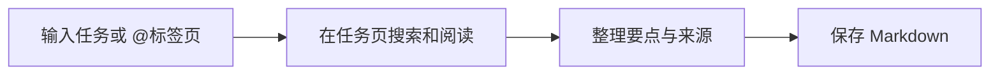

# TabErrand

在 Chrome 侧栏里和自己的模型对话。用 `@` 引用标签页，让 Agent 搜索、整理来源并保存 Markdown。

> TabErrand v0.2.0 可在本地加载。下图是对话侧栏的运行画面，使用受控网页的示例数据。


[本地加载](#本地加载) · [任务示例](#一条任务从哪里开始) · [技术方案](docs/technical-design.md)

## 一条任务从哪里开始

> 在小红书搜索「前端面经」，阅读 5 条相关笔记，按知识点、项目追问和面试流程整理，附上原文链接，保存为 Markdown。

侧栏收到任务后，TabErrand 会新建一组任务标签页，在你授权的站点里搜索、筛选并打开结果。点击「接管网页」会先暂停后续动作，再切到正在处理的页面。需要登录或遇到验证码时，侧栏会提示你打开相应页面，处理完可点「继续任务」。任务标签页可以逐个打开，完成后也可以一次关闭。

手上已经有一页相关内容时，在侧栏输入 `@` 选中它。例如「从 `@小红书首页` 开始找前端面经」。选中的页面提供上下文，后续搜索在任务标签页中进行。也可以用它做跨页对比，例如「比较 `@文档 A` 和 `@文档 B` 的接入要求，保存一份差异清单」。



整理完成后，Markdown 会自动保存到 Chrome 的下载目录。侧栏提供预览、「在文件夹中显示」和「另存为」。如果只收集到部分材料，侧栏会显示缺了什么，并保留已收集的草稿。实际保存位置和提示遵循 Chrome 的下载设置。

### Markdown 节选

以下内容和链接用于展示文件格式。

```markdown
# 前端面经整理

## 知识点
- 浏览器缓存：整理协商缓存与强缓存的面试问法。[1]

## 项目追问
- 准备一例性能优化，讲清定位过程、改动和验证数据。[2]

## 来源
1. [缓存相关问答](https://example.org/interviews/cache)
2. [项目复盘示例](https://example.org/interviews/project-review)
```

## 连续对话

底部输入框可以直接提问，也可以用 `@` 附上标签页。按 Enter 发送，Shift+Enter 换行。浏览动作和接管入口出现在对应的助手消息里。接着追问时，对话会带上近期回复和已经采集的来源。

点击「新对话」开始独立对话，从「历史」可以回到已有记录。报告正文和来源直接显示在消息里，文件卡片提供「另存为」和「在文件夹中显示」。

打开普通 HTTPS 网页、清空输入框后，可以点「总结本页」或「翻译本页」。助手读取当前页最多 5,000 字符的可见正文，把摘要或简体中文译文发到对话里。

在「设置 → 站点指引」可以保存某个站点的搜索入口、筛选步骤等经验。例如，为 `www.xiaohongshu.com` 保存「从首页搜索框输入关键词，按最新排序」。对应站点进入授权范围后，指引会随浏览任务发给模型。

## 首版能力

| 能力 | 你可以做什么 |
| --- | --- |
| `@标签页` | 从当前窗口挑选一个或多个已打开的页面作为参考。 |
| 任务标签组 | 让 Agent 在专用标签页里导航、输入搜索词、筛选、滚动和阅读。 |
| 进度与接管 | 查看操作进度、暂停并切到当前页、继续任务或关闭该任务打开的标签页。 |
| 网页快捷操作 | 总结或翻译当前页可见正文，在对话里查看。 |
| 站点指引 | 按站点保存自己的搜索和筛选经验，下次浏览该站点时供模型参考。 |
| 带来源的 Markdown | 在侧栏预览按主题整理的内容，打开原文核对，在本地找到文件。 |
| 自选模型 | 填入自己的 API Key。首批验收 OpenAI 和 DeepSeek，使用 Chat Completions 工具调用协议。 |

首版只需安装 Chrome 扩展，可以使用当前 Chrome 会话访问已授权的页面。资料整理任务在侧栏打开时运行，关闭侧栏会暂停后续操作。文件和任务记录保存在本机。使用远程模型时，任务描述和整理所需的页面片段会发送给你配置的服务商。

## 本地加载

准备 Node.js 22.12+ 和 Chrome 116+。在仓库根目录运行：

```bash
npm ci
npm run build
```

1. 在 Chrome 打开 `chrome://extensions`，打开「开发者模式」，点「加载已解压的扩展程序」，选择构建输出 `.output/chrome-mv3`。
2. 点击工具栏的 TabErrand 图标打开侧栏。在「设置」中选 OpenAI 或 DeepSeek，填写自己的 API Key，再点「测试连接」或「保存并授权」。默认模型分别是 `gpt-4.1-mini` 和 `deepseek-flash`，可修改模型 ID。
3. 在同一个 Chrome 窗口打开目标网页。回到侧栏输入 `@` 选中标签页，写明要搜什么、读几条资料和怎么整理，点击「发送」并授予任务站点权限。
4. 在对应的助手消息中查看采集结果。报告完成后，Chrome 会尝试保存到默认下载位置下的 `TabErrand/`。可以在报告卡片预览、另存为或打开文件夹。

API Key 仅保存在当前 Chrome 会话。任务需要登录或验证码时，打开任务页手动处理，再回侧栏点击「继续任务」。

## 开发

`npm run typecheck` 检查类型，`npm run dev` 启动 WXT 开发环境。接入方式、任务状态与验收范围见 [技术方案](docs/technical-design.md)。

## 参考项目

- **Kaze** 的侧栏、任务标签组、页面翻译和站点技能启发了浏览交互。**DeepSeek** 的聊天和历史记录启发了对话布局。[Kaze 官网](https://kaze.build/) · [Kaze 项目说明](https://github.com/jackwener/Kaze#readme) · [DeepSeek](https://www.deepseek.com/en/download/)
- **Browser Use** 的 README 用任务演示展示 Agent 实际做了什么，再给出入口。[Browser Use README](https://github.com/browser-use/browser-use#readme)
- **Nanobrowser** 展示了 Chrome 扩展与自备模型的组合，README 给出了模型配置和首条任务的路径。[Nanobrowser README](https://github.com/nanobrowser/nanobrowser#readme)
