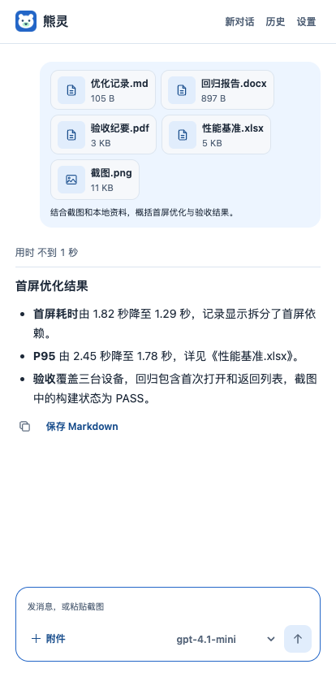
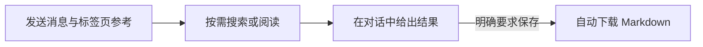

# 熊灵 · Spirit Bear


在 Chrome 侧栏里用自己的模型对话。熊灵可以分析截图和本地文件、阅读当前网页、搜索资料和整理来源，需要时把结果保存成 Markdown。

> 熊灵 v0.2.0 可在本地加载。下图是对话侧栏的运行画面，使用受控网页的示例数据。



[本地加载](#本地加载) · [任务示例](#一条任务从哪里开始) · [技术方案](docs/technical-design.md)

## 一条任务从哪里开始

> 在小红书搜索「前端面经」，阅读 5 条相关笔记，按知识点、项目追问和面试流程整理，附上原文链接，保存为 Markdown。

侧栏收到任务后，熊灵会在后台任务标签页里搜索、筛选和读取结果。搜索触发的新结果页也会加入当前任务组。结果页来自新站点时，点击「授权并继续」即可接着查。点击「接管网页」会先暂停后续动作，再切到正在处理的页面。需要登录或遇到验证码时，侧栏会提示你打开相应页面，处理完可点「继续任务」。任务标签页可以逐个打开，完成后也可以一次关闭。

当前 HTTPS 标签页会自动出现在输入框的参考列表里。打开小红书首页后，可以直接说「在这里找前端面经」。输入 `@` 可以加入其他页面，例如「比较 `@文档 A` 和 `@文档 B` 的接入要求」。



这条示例明确要求保存。完整报告会自动下载到 Chrome 的下载目录，侧栏提供「在文件夹中显示」和「另存为」。如果只收集到部分材料，侧栏会显示缺了什么，并保留已收集的草稿。

### Markdown 节选

以下内容和链接用于展示文件格式。

```markdown
# 前端面经整理

## 知识点
- 浏览器缓存：整理协商缓存与强缓存的面试问法。[1]

## 项目追问
- 准备一例性能优化，讲清定位过程、改动和验证数据。[2]

## 来源
1. [缓存相关问答](https://example.org/interviews/cache)
2. [项目复盘示例](https://example.org/interviews/project-review)
```

## 标签页和账户页面

- 发「把当前窗口的 V2EX 标签页放进论坛组」来分组，也可以按标题或分组名称指定标签页、调整顺序、取消分组或切到指定页。
- 用 @ 选中几页后发「对比这些页面的主要结论」，或发「找出当前窗口里的面经标签页，汇总每篇的要点」。熊灵逐页读取正文，按来源整理。
- 从产品文档问自己的余额、账单或用量时，熊灵从可见链接寻找账户入口，在后台打开并读取页面。登录或授权完成后可以继续读取目标页。

## 连续对话

侧栏「设置 → 界面语言」支持简体中文和 English。首次打开时按 Chrome 语言选择默认界面，之后记住你的选择。网页快捷操作「总结本页」和「翻译本页」会按所选语言输出。

输入框默认带上活动的 HTTPS 标签页，发送前可以移除。当前页的标题和站点随引用进入任务。Agent 需要读取未授权站点的正文时，会在该轮对话中请求权限。按 Enter 发送，Shift+Enter 换行。

在输入框切换模型，并按当前模型支持的档位调整「思考」强度。发送后可以看到当前处理状态。展开回答上方的「用时」，查看查找思路、网页操作和来源记录。支持流式输出的模型会逐段显示正文，运行中可以从输入框暂停。追问会带上近期回复和已采集的来源。

点击「新对话」开始独立对话，打开「历史」页可查看并继续已有对话。结果默认显示在对话中。需要下载时，在指令里写「保存为 Markdown」，或者事后从回复下方点击「保存 Markdown」。

在输入框点击「附件 → 添加截图或文件」，也可以直接粘贴截图或把文件拖进输入框。支持常见图片、文本、代码、CSV、DOCX、XLSX 和有文字层的 PDF。发送前可以预览或移除。发送时，图片和本地提取的正文会交给当前选择的模型。已发送的附件随对话历史保存在本机，点「复用上次附件」可以带着附件追问。截图需要支持图片输入的模型，例如 DeepSeek `deepseek-flash` 或 OpenAI `gpt-4.1-mini`。

打开普通 HTTPS 网页、清空输入框后，可以点「总结本页」或「翻译本页」。助手读取当前页最多 5,000 字符的可见正文，用所选界面语言生成摘要或译文。

## 首版能力

| 能力 | 你可以做什么 |
| --- | --- |
| 标签页上下文 | 默认附上当前页，用 `@` 选择其他页面。 |
| 任务标签组 | 让 Agent 在专用标签页里导航、输入搜索词、筛选、滚动和阅读。 |
| 进度与接管 | 查看操作进度、暂停并切到当前页、继续任务或关闭该任务打开的标签页。 |
| 网页快捷操作 | 总结或翻译当前页可见正文，在对话里查看。 |
| 带来源的 Markdown | 在侧栏预览按主题整理的内容，打开原文核对，在本地找到文件。 |
| 自选模型 | 连接 OpenAI、DeepSeek 或自定义兼容端点。可拉取端点的模型列表，也能手填多个模型 ID，在输入框切换。 |

首版只需安装 Chrome 扩展，可以使用当前 Chrome 会话访问已授权的页面。资料整理任务在侧栏打开时运行，关闭侧栏会暂停后续操作。文件和任务记录保存在本机。使用远程模型时，任务描述和整理所需的页面片段会发送给你配置的服务商。

## 本地加载

准备 Node.js 22.12+ 和 Chrome 116+。在仓库根目录运行：

```bash
npm ci
npm run build
```

1. 在 Chrome 打开 `chrome://extensions`，打开「开发者模式」，点「加载已解压的扩展程序」，选择构建输出 `.output/chrome-mv3`。
2. 点击工具栏的熊灵图标打开侧栏。英文 Chrome 中的名称是 Spirit Bear。在「设置」里连接 OpenAI、DeepSeek 或自定义端点，填写 API 地址和密钥。点击「拉取模型」后从下拉框添加模型 ID，也可以每行手填一个，再点「连接并测试」。自定义本机兼容端点支持 HTTP。
3. 回到对话，在输入框选择模型。直接提问，或打开目标网页后交给 Agent 一个任务。当前页自动附上，也可以用 `@` 添加其他页面。
4. 在对应的助手消息中查看结果。明确要求保存时，Chrome 会尝试将完整结果下载到默认位置下的 `熊灵/` 或 `Spirit Bear/`，文件夹名称跟随 Chrome 语言。

模型连接里的厂商标识来自 [OpenAI 开发者站点](https://developers.openai.com/) 和 [DeepSeek API 文档](https://api-docs.deepseek.com/)。API Key 仅保存在当前 Chrome 会话。任务需要登录或验证码时，打开任务页手动处理，再回侧栏点击「继续任务」。

## 开发

扩展使用 TypeScript、React 和 WXT，侧栏通过 LangGraph.js 的 `StateGraph` 编排模型、工具和回复，Service Worker 派发实际网页动作并把运行记录写入 IndexedDB。

`npm run typecheck` 检查类型，`npm run dev` 启动 WXT 开发环境。接入方式、任务状态与验收范围见 [技术方案](docs/technical-design.md)。

## 参考项目

- **Kaze** 的侧栏、任务标签组和页面翻译启发了浏览交互。**DeepSeek** 的聊天和历史记录启发了对话布局。[Kaze 官网](https://kaze.build/) · [Kaze 项目说明](https://github.com/jackwener/Kaze#readme) · [DeepSeek](https://www.deepseek.com/en/download/)
- **Codex** 的对话轮次、任务进度和暂停入口用于参考侧栏的工作流程。[Codex App Server](https://learn.chatgpt.com/docs/app-server) · [长任务交互](https://learn.chatgpt.com/docs/long-running-work)
- **Browser Use** 的 README 用任务演示展示 Agent 实际做了什么，再给出入口。[Browser Use README](https://github.com/browser-use/browser-use#readme)
- **Nanobrowser** 展示了 Chrome 扩展与自备模型的组合，README 给出了模型配置和首条任务的路径。[Nanobrowser README](https://github.com/nanobrowser/nanobrowser#readme)
