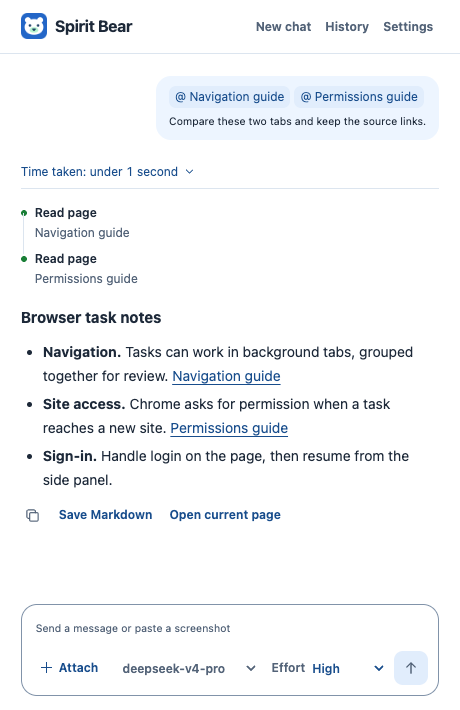

<div align="center">


# 熊灵 · Spirit Bear

用你选的模型，在 Chrome 侧栏操作网页。

[English](README.md) · [从源码加载](#从源码加载) · [试几个任务](#试几个任务) · [技术方案](docs/technical-design.md)

</div>

打开网页，直接在侧栏说你想做什么。熊灵能搜索、读取和比较标签页，也能按指令给标签页分组。输入 `@` 引用其他页面，或者把截图和文件附在消息里。想留一份结果时，在任务里写「保存为 Markdown」。

<p align="center">
  
  <br>
  <sub>运行截图。示例使用两个本地测试页面。</sub>
</p>

## 从源码加载

需要 **Chrome 116+**、**Node.js 22.12+**，以及一个模型 API Key 或可访问的本机兼容端点。

```bash
git clone https://github.com/RainPot/SpiritBear.git
cd SpiritBear
npm ci
npm run build
```

1. 打开 `chrome://extensions`，开启「开发者模式」。点击「加载已解压的扩展程序」，选项目里的 `.output/chrome-mv3` 目录。
2. 从工具栏打开熊灵，进「设置 → 模型连接」。可以连 OpenAI、DeepSeek，也可以填自定义的 OpenAI 兼容端点。
3. 填好 API 地址和密钥，点「连接并测试」。Chrome 提示授权时，允许访问这个端点。模型列表会自动加载。想换默认模型时，在连接旁点「管理」，从下拉框选。
4. 回到对话，在输入框旁切换模型。模型支持思考强度时，也可以在这里调档位。

## 试几个任务

| 场景 | 可以这样说 |
| --- | --- |
| 比较资料 | 「对比 `@接入文档` 和 `@权限说明`，列出需要注意的差异，附上原文链接。」 |
| 搜索并整理 | 「在小红书搜前端面经，读 3 条相关笔记，按题型整理，保存为 Markdown。」 |
| 整理标签页 | 「把当前窗口的 V2EX 标签页放进论坛组。」 |
| 查账户信息 | 「帮我看看这个账号还剩多少钱。」从文档页出发时，熊灵会沿可见入口浏览到账户后台。 |
| 看截图和文件 | 附上截图、PDF、表格或文本，再说明你想从里面找什么。 |

当前 HTTPS 标签页默认随消息带上，发送前可以移除。「历史」是独立页面，点击记录可以继续聊。想快速读一页，可以点「总结本页」或「翻译本页」。

## 模型连接

自定义端点需要兼容 Chat Completions，并提供 `GET /models`。熊灵在连接时读取模型目录，打开侧栏后也会刷新已连接端点的目录。DeepSeek 返回 `deepseek-v4-pro` 时，输入框就能选 Pro。连接时会用默认模型测试工具调用，思考强度按模型保存。 [OpenAI 模型列表](https://developers.openai.com/api/reference/resources/models/methods/list) · [DeepSeek 模型列表](https://api-docs.deepseek.com/api/list-models/)

## 网页权限和数据

- 任务在后台标签页里浏览。遇到登录或验证时，在目标页处理好，再回侧栏继续。
- 浏览新站点需要 Chrome 授权。任务描述、用到的网页片段和附件内容会发给你选的模型端点。
- 对话和附件保存在本机，API Key 保存在当前 Chrome 会话。导出的 Markdown 由 Chrome 下载。

## 开发

```bash
npm ci
npm run typecheck
npm run dev
```

侧栏用 React 和 LangGraph.js 跑对话与工具循环，Service Worker 执行 Chrome 操作并记录回执。构建由 WXT 处理。网页观察、授权和报告验收的实现见 [技术方案](docs/technical-design.md)。

浏览交互参考了 [Kaze](https://kaze.build/)、[Nanobrowser](https://github.com/nanobrowser/nanobrowser) 和 [Browser Use](https://github.com/browser-use/browser-use)。厂商标识来自 [OpenAI 开发者站点](https://developers.openai.com/) 和 [DeepSeek API 文档](https://api-docs.deepseek.com/)。
