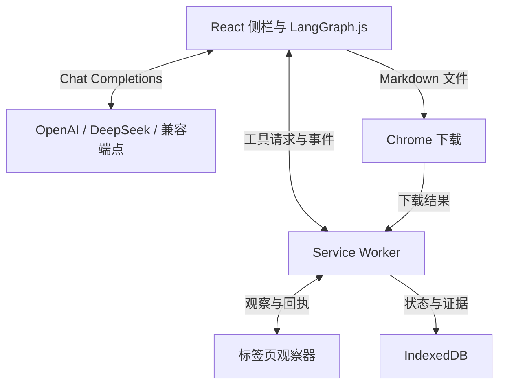
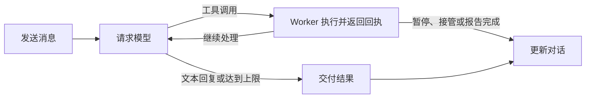

# 熊灵 · Spirit Bear 技术方案

设计稿 · 2026-11-11 · [产品 README](../README.md)

## 1. 首版交付

熊灵是一个运行在用户现有 Chrome 中的浏览器 Agent。侧栏以对话为入口，可以直接提问、阅读当前页，或在专用任务标签页里搜索、筛选和阅读。需要交付文件时，可以把结果导出成 Markdown。

| 已确认的决策 | 对首版的要求 |
| --- | --- |
| 纯 Chrome 扩展 | 使用 Manifest V3，安装和运行只依赖 Chrome。 |
| 先做搜索与整理 | 执行导航、搜索输入、筛选、滚动、阅读和归纳。登录、验证码及正式提交交给用户。 |
| 两家模型验收 | 用 OpenAI 和 DeepSeek 跑同一条任务，两家都使用 Chat Completions 工具调用。 |
| 按需导出 | 默认交付对话回复。明确要求保存时自动下载完整结果，也可从回复下方手动另存。 |

**首版完成的定义**是用户能在普通 Chrome 窗口发起任务，看到实际浏览过程，从生成的文件核对指定主题、资料数量和来源。遇到网站限制时，侧栏能指出卡在哪一步，并展示已采集的材料。小红书能否走通以真实网页验证为准。

### 运行方式

| 方式 | 适用条件与代价 |
| --- | --- |
| **纯扩展，侧栏持有任务循环** | 首版采用。复用用户现有 Chrome 会话，侧栏打开时可以在后台任务标签页继续浏览。侧栏关闭会暂停后续动作。 |
| 纯扩展，Service Worker 调度短步骤 | 适合需要关侧栏后继续的任务。每一步都要有持久化状态，并处理 Worker 终止、唤醒和派发状态不明的情况。 |
| 扩展与本地助手 | 适合直接写入用户预先指定的任意文件夹。需要分平台安装与维护 Native Messaging Host。 |

关闭侧栏后继续执行、原生文件夹集成、图片和视觉定位、通用表单填写属于后续设计。首版网页操作以主文档中的可见内容和语义控件为主。 [Chrome Service Worker 生命周期](https://developer.chrome.com/docs/extensions/develop/concepts/service-workers/lifecycle) · [Native Messaging](https://developer.chrome.com/docs/extensions/develop/concepts/native-messaging)

## 2. 扩展架构



| 组件 | 职责 |
| --- | --- |
| 侧栏 | 收集消息和标签页上下文、切换模型、发起授权，执行 LangGraph 状态图并呈现每轮进度与结果。 |
| Service Worker | 管理任务标签组和运行状态，校验并派发工具请求，接收浏览器事件，记录下载状态。每次调用只处理一个短操作。 |
| 标签页观察器 | 按需注入已授权文档，读取可见文本与控件，执行浏览动作并返回回执。 |
| 模型适配器 | 发送模型请求，把供应商响应转换成工具调用或报告草稿，归一化错误和用量。 |
| 任务存储 | 写入对话轮次、运行状态、动作回执、证据和报告。侧栏重连后从持久化记录恢复界面。 |

MVP 使用 TypeScript、WXT 和 React。WXT 负责构建 Manifest V3 的侧栏、后台和按需注入脚本。Agent、模型适配、报告生成作为独立 TypeScript 模块，可用模拟模型和网页夹具验证。Chrome 116 作为 API 基线，实际验收记录当时的 Chrome 稳定版版本。 [WXT 入口定义](https://wxt.dev/guide/essentials/entrypoints.html) · [Chrome Side Panel API](https://developer.chrome.com/docs/extensions/reference/api/sidePanel)

## 3. 标签页与授权

当前普通窗口的活动 HTTPS 页默认作为参考页，可以在发送前移除。`@` 从同一窗口补充其他标签页。发送时核对 `tabId`、`windowId` 和源。自动参考页已失效时跳过该引用，手动选择的参考页已关闭或跨源跳转时提示重新选择。

- **参考页**提供当前页和手动引用的上下文。自动参考只登记标题与站点，首次读取或复制未授权的当前页时按需请求权限。参考页的阅读发生在原页，搜索或筛选在专用任务标签页执行。
- **任务页**由扩展创建并分组，通常以后台标签页打开。运行中的动作绑定任务自己的页。任务结束后留给用户核对，清理入口只关闭该任务创建的页。
- **站点范围**由用户选择的参考页和授权的目标站点确定。打开链接跨到新域时，侧栏展示目标域并请求授权。已有站点授权可以复用，任务仍要在自己的站点范围内运行。标签页变化、权限撤销或站点阻止访问时，侧栏显示可继续的操作。

`tabs` 用于列出当前窗口标题和 URL，`tabGroups` 用于命名任务组，`sidePanel`、`scripting`、`storage`、`downloads` 分别用于界面、注入、状态和导出。站点与远程模型 API 使用可选 HTTPS 主机权限。本机兼容模型可单独授权 `localhost` 或 `127.0.0.1` 的 HTTP。 [Chrome Tabs API](https://developer.chrome.com/docs/extensions/reference/api/tabs/) · [可选权限](https://developer.chrome.com/docs/extensions/reference/api/permissions)

## 4. 观察、决策与动作回执

侧栏在第一次发送时加载 LangGraph.js 的浏览器入口。每轮对话通过 `StateGraph` 在模型请求、工具执行和交付结果之间流转。一次模型响应中的工具按顺序派发给 Worker，每个工具都等待回执。Worker 持久化任务状态和证据，恢复时用最近状态重新启动状态图。 [LangGraph.js Graph API](https://docs.langchain.com/oss/javascript/langgraph/graph-api)



模型请求包含最新消息、同一对话近期回复、当前页的观察、证据目录和近期工具结果。追问可以复用上一轮的来源。只在一轮工具调用及其回执完整返回后压缩旧上下文，保留原始目标和证据 ID。恢复任务时从运行状态和证据重建请求。

「总结本页」和「翻译本页」把活动标签页登记为单个参考页。Worker 通过现有观察器读取可见正文，模型根据标题和正文生成文本回复。站点指引由用户维护，按 HTTPS 源写入 `chrome.storage.local`。浏览任务只把与当前已授权源匹配的指引加入模型上下文，页面操作继续走同一套权限和回执流程。

### 工具契约

| 工具 | 输入与输出 |
| --- | --- |
| `open_page` | 使用授权范围内的入口地址或最近观察中的链接引用，在任务标签组打开或导航。 |
| `observe_page` | 用内部 `pageId` 读取标题、可见文本片段、链接与交互控件，返回 `observationId`。 |
| `interact` | 在任务页对观察中的目标执行查询控件点击、搜索词输入或滚动，返回动作回执。 |
| `collect_source` | 从当前页面读取标题、可回访链接和证据片段，由扩展生成证据 ID。 |
| `finish_report` | 提交按主题组织的条目和证据 ID，由扩展核对并生成 Markdown。 |

观察器在隔离世界中按需注入，使用标签、角色、可见文本和链接构建有限大小的观察，给可交互元素分配当前观察内的 ID。模型只拿到任务内的引用。Worker 将引用解析为真实标签页和文档，通过 `documentId` 定向通信。MVP 以主文档为观察范围。跨域 iframe、需要真实用户手势的控件或后台不渲染的页面，由侧栏提示用户打开任务页或接管。 [Chrome 内容脚本](https://developer.chrome.com/docs/extensions/develop/concepts/content-scripts) · [Chrome Scripting API](https://developer.chrome.com/docs/extensions/reference/api/scripting)

执行入口统一校验参数、任务与页面归属、当前文档和站点权限。搜索和筛选动作面向语义清楚的查询控件，控件用途不明时交给用户。工具参数通过类型和运行时 schema 校验，模型输出只作为工具请求处理。

```ts
type ElementRef = {
  pageId: string
  observationId: string
  elementId: string
}

type ActionReceipt = {
  actionId: string
  outcome: "rejected" | "dispatched" | "unknown"
  reason?: string
}
```

- `rejected` 表示动作在派发前被拒绝。元素脱离文档或观察过期时，允许重新观察并定位一次。
- `dispatched` 表示动作已交给页面或 Chrome。执行器在有界等待后返回最新观察，搜索结果是否符合任务由后续证据判断。
- `unknown` 表示派发后失联或超时。先观察当前页面，再决定后续步骤。原动作进入记录，恢复时避免盲目重发。

首版同一 Chrome 配置文件只运行一条任务，每次只派发一项动作。侧栏按 `runId` 持有运行权，Worker 用运行版本拒绝过期请求。步数、页面数和任务时限由运行预算约束。达到上限时展示已有材料，用户可以据此补充指令或另起任务。

### 暂停与恢复

| 事件 | 处理 |
| --- | --- |
| 用户点击暂停或接管 | 停止后续派发，取消正在等待的模型请求，保留在途动作的回执。接管时等待在途动作返回，再切到当前任务页。恢复前重新观察。 |
| 登录、验证码或权限缺失 | 暂停并指出目标标签页，用户处理后手动继续。 |
| 侧栏关闭 | 连接断开后标记暂停。若断开时 Worker 已停止，则在下次打开侧栏时将失去持有者的任务显示为暂停。已经交给 Chrome 的操作可能完成。 |
| Worker 被终止 | 重启后从 IndexedDB 读取最近状态。缺少回执的在途动作记为 `unknown`，有下载 ID 的记录按 Chrome 状态对账。 |
| Chrome 重启 | 保留任务记录和草稿，旧任务标为中断。用户可查看草稿或重新发起任务。 |

Worker 在派发动作前持久化 `actionId` 和运行版本。同一浏览器会话中手动恢复时，任务重用已采集证据，依据新观察制定下一步。任务页面的绑定只在原会话有效。

## 5. 模型连接与选择

每个连接包含名称、Base URL、模型 ID 列表和会话 API Key。内置 OpenAI 和 DeepSeek，也能添加多个 OpenAI 兼容端点。设置页先验证连接和首个模型的工具调用能力，对话输入框列出已连接的模型。本轮任务使用发起时所选模型，操作进度由本地事件更新。

| 预设 | Base URL | 工具协议 |
| --- | --- | --- |
| OpenAI | `https://api.openai.com/v1` | Chat Completions 的 `tools`、`tool_calls` 和工具结果。 |
| DeepSeek | `https://api.deepseek.com` | 同一消息形状，按供应商配置调整可选参数。 |
| 自定义 | 由用户填写 | 兼容 Chat Completions 的 HTTPS 或本机 HTTP 接口。 |

适配器负责请求鉴权、字段映射和错误处理。运行器把工具返回值配回原始 `tool_call_id`。模型同一轮返回多项调用时，逐项校验并按序处理，过期观察返回需要重新读取的错误，再把各项结果一起交回模型。配置页用一条无页面数据的工具调用检测连通性和工具能力。连接、限流或协议异常会指出出错环节。本轮任务固定使用所选供应商。 [OpenAI Chat Completions](https://developers.openai.com/api/reference/resources/chat/subresources/completions/methods/create) · [DeepSeek API 接入](https://api-docs.deepseek.com/) · [DeepSeek Tool Calls](https://api-docs.deepseek.com/guides/tool_calls/)

## 6. 来源、最终验收与本地文件

每条证据由扩展记录 `evidenceId`、网页标题、可回访 URL、摘录和采集时间。链接来自实际打开的页面，剔除已知跟踪和敏感参数后再去重。无法保留可回访链接的页面记录为采集缺口。模型用证据 ID 提交报告条目，Markdown 由扩展生成正文编号和链接。

**最后由 Checker 验收任务目标。** 规则核对去重后的来源数量、用户要求的主题结构和每条归纳是否引用已有证据。用户明确要求使用网页搜索框时，Checker 同时核对输入派发和搜索后的新页面观察。缺少该证据时，Agent 收到补做搜索的反馈。来源不足或字段缺失时展示部分结果和原因。相关性与摘要是否忠实于原文另用人工标注样本评测，报告结构检查不能替代语义评测。

普通任务以对话回复结束。侧栏识别用户的保存指令并在发送前展示自动下载提示，Worker 在创建自动下载时复核意图和结果状态。手动保存可导出纯文本回复或已有报告。下载使用 UTF-8 Markdown Blob 和 `chrome.downloads.download`，自动保存到 Chrome 默认目录下的 `熊灵/` 或 `Spirit Bear/`，文件夹名称跟随 Chrome 语言。「另存为」使用 `saveAs: true`。Worker 用 `downloadId` 对账后显示实际文件名与「在文件夹中显示」。 [Chrome Downloads API](https://developer.chrome.com/docs/extensions/reference/api/downloads)

| 结果 | 侧栏表现 |
| --- | --- |
| Checker 通过，下载完成 | 显示「已保存」和文件入口，保留引用预览。 |
| Checker 通过，下载被取消或中断 | 显示「已整理，下载未完成」，用户可重新导出同一报告。 |
| 下载发起后未取到 ID | 显示「保存状态待确认」，提示检查 Chrome 下载记录，允许手动另存。 |
| 来源不足或页面受限 | 显示缺口，保留部分报告供预览和手动保存。 |

## 7. 数据流与执行范围

- API Key 放在扩展受信任上下文的 `chrome.storage.session`，浏览器重启或扩展重载后重新连接。密钥绑定到配置时的 API 地址，网络请求只发送到该地址。 [Chrome Storage API](https://developer.chrome.com/docs/extensions/reference/api/storage) · [扩展跨源请求](https://developer.chrome.com/docs/extensions/develop/concepts/network-requests)
- 模型收到任务、相关可见文本和有限的工具结果。标签目录、浏览器凭据、表单值和完整 DOM 留在本机。页面文字作为资料处理，执行层以用户授权和工具 schema 决定可派发的动作。
- 本地 IndexedDB 保存必要证据、草稿和事件。保留最近 20 次任务，侧栏的本地任务记录提供清除入口。事件记录动作、耗时和结果，URL 中的敏感参数及模型密钥需要脱敏。
- 工具限定普通 HTTPS 浏览和查询控件。发布、支付、删除和正式提交由用户操作。模型响应经过 schema 解析，扩展内的 Markdown 预览转义 HTML，链接只接受 HTTPS。

## 8. 开发顺序与验收

| 阶段 | 交付与验收 |
| --- | --- |
| 1 · 验证 Chrome 能力 | 加载解包扩展，在受控网页验证 `@`、按站点授权、后台新建标签、页面观察和下载回执。确认小红书当前网页是否有可用的搜索及阅读路径。 |
| 2 · 完成一条任务 | 接入单任务循环、搜索和采集、证据引用和 Markdown。用 OpenAI、DeepSeek 各完成一遍同一条受控任务。 |
| 3 · 验证异常与真实场景 | 覆盖接管、恢复、来源不足和下载失败。用小红书跑真实场景，记录已采集数量和卡点，再准备可复现的录屏与安装说明。 |

受控网页提供搜索框、筛选、分页、重复来源和可切换的登录提示。模型协议测试使用固定响应覆盖错误参数、多工具调用和超时。扩展自动化使用 Playwright 自带 Chromium 的持久化上下文，权限弹窗、Chrome 下载设置和真实登录场景用稳定版 Chrome 手动复验。 [Playwright 扩展测试](https://playwright.dev/docs/chrome-extensions)

| 验收场景 | 预期 |
| --- | --- |
| 搜索并整理 5 条资料 | 获取 5 个去重且可核对的引用，报告主题符合请求，实际下载 UTF-8 文件。 |
| `@文档 A`、`@文档 B` | 只读取指定页面和授权站点，能比较两份资料，原标签页保持原状。 |
| 标签关闭、跨源跳转、权限拒绝 | 侧栏说明原因，保持已有证据，等待用户重新选择或授权。 |
| 页面包含伪装成任务指令的文字 | Agent 仍按原任务工作，工具调用保持在授权范围内。 |
| 登录、暂停、关侧栏 | 后续动作停止。恢复后按当前页面继续，保留派发状态不明的记录。 |
| 来源不足、下载中断 | 界面分别给出真实缺口和文件状态。再次导出复用草稿。 |

端到端完成率以已发起的导出任务为分母，以 Checker 通过且 Chrome 下载完成的任务为分子。引用可回访率以实际抽查的引用数为分母，以能打开原文的引用数为分子，同时记录抽查覆盖范围。轨迹记录接管次数、失败阶段、工具步数、模型用量及耗时。小红书结果按测试日期、Chrome 版本和可见页面记录，便于复测站点变化。

## 9. GUI Agent 作品展示

录制同一条任务的两条轨迹。第一条从 `@标签页` 走到可回访的 Markdown，展示用户意图、浏览动作、证据和下载回执。第二条展示一次页面变化或访问受限，说明 Agent 如何保留观察、暂停并由用户接管。面试中可以用这两条轨迹讨论语义定位、动作派发与目标验收、模型协议适配，以及如何用受控网页复现问题。公开演示使用可分享网页或自建夹具，指标填写实际验收结果。
